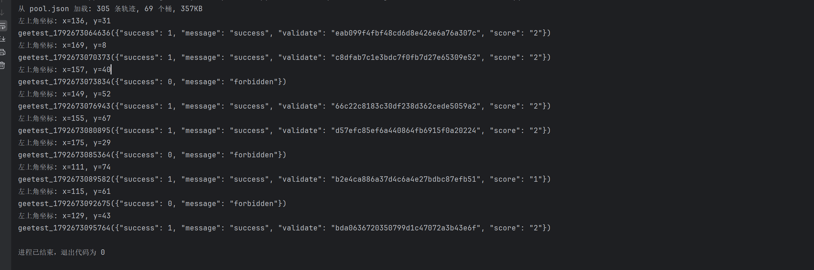
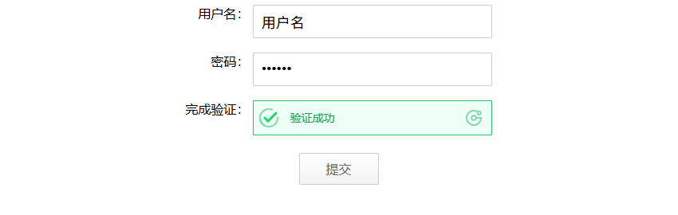
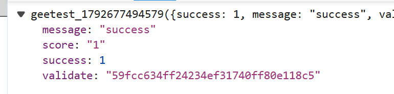
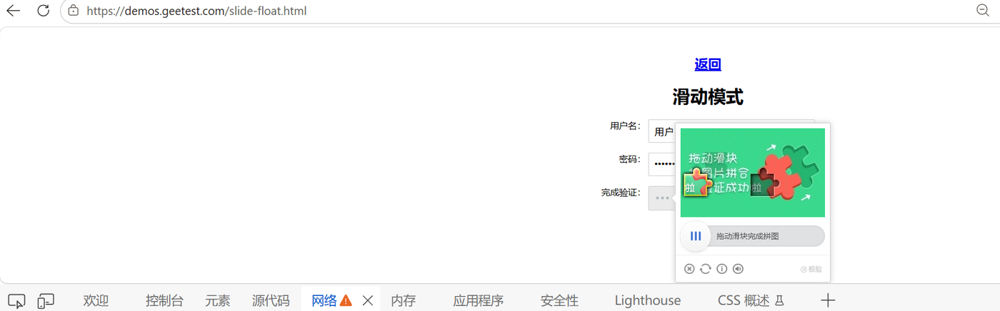
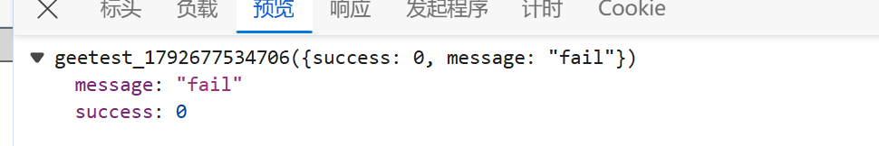

# 极验3 滑块验证纯协议实现

> Geetest v3 滑块验证码的纯协议复现：`requests` + `execjs`，不依赖浏览器自动化。
> 覆盖注册、w1/w2/w3 加密、背景图还原、缺口测距、真人轨迹回放、结果提交完整链路。

## 免责声明

本项目仅用于 **极验官方演示站（demos.geetest.com）的逆向学习与技术研究**。
请勿用于任何未授权的真实业务站点。验证码绕过可能违反目标站点的服务条款，
使用前请自行确认授权与合规性。

---

## 成功验证

连续运行 9 次：**6 次 success，3 次 forbidden**（纯协议 + 轨迹池）。



[查看原图](docs/media/terminal-results.png)

页面验证成功：



`ajax.php` 返回：



第一次手动闭环时的“拼图验证成功”浮层：



### 失败对照

`fail` 是距离/轨迹层，`forbidden` 是 w/会话层，两者不要混为一谈：



> 终端截图来自一次连续运行：6 次 success、3 次 forbidden。
> 个别 `forbidden` 属于会话/风控波动，不代表轨迹失败；详细错误码对照见
> [docs/逆向过程.md](docs/逆向过程.md)。

---

## 一、项目特点

- **纯协议**：不启动浏览器，全部请求由 `requests` 完成；JS 加密逻辑由 `execjs` 调用本地 Node.js 执行。
- **完整链路**：从 `register-slide` 注册到最终 `ajax.php` 提交，包含 w1 / w2 / w3 三代参数。
- **图片还原**：将 312×160 的乱序背景图按 `Ut[52]` 置换还原为 260×160。
- **轨迹复用**：内置 305 条真人滑动轨迹，按终点距离 3px 分桶，随机取样并微扰动，避免重复轨迹被识别。
- **可扩展**：`w_*.js` 与 Python 主流程分离，方便替换参数、更新加密逻辑。
- **配套轨迹池项目**：[slider-trajectory-pool](https://github.com/xxhymd-12/slider-trajectory-pool)。
  如果还不理解轨迹池，或者想自己收集真人轨迹、从零构建一个池子，请先读这个仓库；
  本仓库只保留运行所需的 `pool.json` 和 `trajectory_pool.py`。

## 逆向过程

从「浏览器自动化先跑通」到「纯协议稳定提交」的完整过程、踩坑记录和错误码对照，
见 [docs/逆向过程.md](docs/逆向过程.md)。里面记录了 `fail` / `forbidden` /
`param decrypt error` / `used captcha` 分别对应哪一层问题，以及为什么
「参数都对但就是 forbidden」最终是会话状态的问题。

## 二、请求链路

```
demos.geetest.com/slide-float.html
        │
        ▼
demos.geetest.com/gt/register-slide
        │  challenge(32位) + gt
        ▼
get_w1(challenge, key)  ──►  apiv6.geetest.com/get.php?w=w1
        │  s
        ▼
get_w_2(challenge, gt, s, key)  ──►  api.geevisit.com/ajax.php?w=w2   （无感验证）
        │
        ▼
api.geevisit.com/get.php?is_next=true
        │  bg / slice / challenge_new(34位) / s_s
        ▼
下载图片 → restore_slider() → get_distance_robust() → x
        │
        ▼
TrajectoryPool.get_track(x + 2) → guiji（终点 x = 滑动距离）
        │
        ▼
get_w3(challenge_new, passtime, t, guiji, s_s, key)
        │
        ▼
api.geevisit.com/ajax.php?w=w3  →  {"success": 1, ...}
```

### 关键顺序说明

1. `get.php`（w1）必须先拿到 `s`，`w2` 依赖 `s`。
2. 无感验证 `ajax.php`（w2）会下发 `GeeTestAjaxUser` 会话 cookie。
3. 带 `is_next=true` 的 `get.php` 返回新的 `challenge_new`、`s_s`、`bg`、`slice`。
4. 最终提交必须使用 `challenge_new` 和 `s_s` 生成 w3，不能再用注册时的 `challenge`。

## 三、目录结构

```
geetest3-pure-protocol/
├── README.md
├── requirements.txt
├── package.json                 # Node 依赖（node-forge / crypto-js / jsencrypt）
├── .gitignore
├── pool.json                    # 305 条真人轨迹的预建索引
├── trajectory_pool.py           # 轨迹池：分桶 / 取样 / 扰动 / 失败淘汰
├── docs/
│   └── 逆向过程.md               # 从浏览器自动化到纯协议的完整过程与踩坑记录
└── 极验3/
    ├── 极验3.py                 # 主入口（纯协议）
    ├── w_2.js                   # get_w1 / get_w_2
    └── w_3.js                   # get_w3（轨迹加密 + AES + RSA）
```

> 轨迹的采集与构建工具（`collector.html`、`collect_trajs.py`、`轨迹收集/`）在配套仓库
> [slider-trajectory-pool](https://github.com/xxhymd-12/slider-trajectory-pool) 中。
> 本仓库只保留运行所需的 `pool.json` 与 `trajectory_pool.py`，避免重复维护数据。

## 四、环境依赖

| 依赖 | 版本建议 | 用途 |
|------|----------|------|
| Python | 3.10+ | 主流程 |
| Node.js | 18+ | `execjs` 执行 w_*.js |
| requests | ≥2.31 | HTTP 请求 |
| PyExecJS | ≥1.5 | Python 调用 Node |
| Pillow | ≥10.0 | 图片读取与还原 |
| opencv-python | ≥4.8 | Canny + 模板匹配 |
| numpy | ≥1.24 | 数组运算 |
| pandas | ≥2.0 | 仅从 CSV 重建轨迹池时需要 |

Node 侧依赖：

```bash
npm install
```

即安装 `node-forge`、`crypto-js`、`jsencrypt`（见 `package.json`）。

## 五、快速开始

```bash
# 1. Python 依赖
pip install -r requirements.txt

# 2. Node 依赖（在仓库根目录执行）
npm install

# 3. 运行（必须在 极验3/ 目录下，脚本按相对路径读取 JS 与图片）
cd 极验3
python 极验3.py
```

运行后主循环会执行 9 次验证，每次间隔 1 秒；最终提交的响应会直接打印，例如：

```json
geetest_1784856646820({"success": 1, "message": "success",
                       "validate": "164769bb64f392bd4a1a0b27e1491a07",
                       "score": "1"})
```

判定成功可检查 `success == 1` 或 `status == "success"`。

## 六、核心实现

### 6.1 w1 / w2 / w3

| 函数 | 文件 | 输入 | 输出 | 说明 |
|------|------|------|------|------|
| `get_w1` | `w_2.js` | `challenge, key` | w1 | RSA 加密 Config + AES |
| `get_w_2` | `w_2.js` | `challenge, gt, s, key` | w2 | 无感验证参数 |
| `get_w3` | `w_3.js` | `challenge_new, passtime, t, guiji, s_s, key` | w3 | 轨迹加密 + AES + RSA |

`key`（代码中的 `e_e`）是每次运行随机生成的 16 位十六进制 AES 密钥；
最终 w 参数由 `base64(AES(JSON, key)) + RSA(key)` 拼接而成。

### 6.2 w3 的载荷结构

```javascript
oo = {
    "lang": "zh-cn",
    "userresponse": H_2(t, challenge),          // 滑动距离加密
    "passtime": passtime,                       // 轨迹总时长（最后一点 time_ms）
    "imgload": 140,                             // 图片加载耗时
    "aa": encry_2(encry_guiji(guiji), shuzu, s),// 轨迹压缩 + 加密
    "ep": { "v": "7.9.3", "tm": tm, "td": -1 },
    "h9s9": "1816378497",
    "rp": H(gt + challenge.slice(0, 32) + passtime)
}
w3 = base64(AES(JSON.stringify(oo), key)) + uu_u
```

要点：

- `t` 必须等于轨迹最后一点的 x（滑动距离），不是目标桶的距离。
- `passtime` 必须等于轨迹最后一点的 `time_ms`。
- `guiji` 格式为 `[[x, y, time_ms], ...]`，全部为整数。
- 轨迹第一点固定插入 `[-39, -10, 0]`（按下滑块时的偏移）。

> 注意：当前 `极验3.py` 传给 w3 的 `t` 是目标 `distance`。轨迹池按 3px 分桶取样，
> 实际终点可能相差 1~2px。若服务端严格校验两者一致性，建议把调用改为
> `guiji[-1][0]`（即轨迹真实终点），确保 `userresponse` 与轨迹末点完全一致。

### 6.3 背景图还原

极验3 的背景图是 312×160 的乱序图，由 52 个 10×80 的竖条组成：

- 26 列 × 2 行；
- 源图每列步长 12px，实际内容 10px，左侧偏移 1px；
- 用固定的 `Ut[52]` 置换表还原；
- 输出 260×160 的正常背景图。

```python
for dst_idx in range(52):
    src_idx = Ut[dst_idx]
    col, row = src_idx % 26, 0 if src_idx < 26 else 1
    src_box = (col * 12 + 1, row * 80, col * 12 + 11, row * 80 + 80)
    dst = ((dst_idx % 26) * 10, (0 if dst_idx < 26 else 1) * 80)
    restored.paste(img.crop(src_box), dst)
```

### 6.4 缺口测距

`get_distance_robust()` 使用滑块图的 alpha 通道生成掩码，对背景图和滑块图分别做
Canny 边缘检测，再用 `cv2.TM_CCOEFF_NORMED` 做模板匹配，取最大响应位置作为缺口左上角 x。

滑动距离：

```python
distance = x + 2
```

`+2` 是补偿：滑块图不透明内容从第 1 列开始，再加上 1px 的边界校准。
如果更换了图片规格，建议改为从 alpha 的 bbox 动态推导，而不是写死。

### 6.5 轨迹池

`trajectory_pool.py` 的核心逻辑：

```
目标距离 D
   │
   ├─ 按 D // 3 找到桶（容差 ±3px）
   ├─ 桶内有可用轨迹 → 随机取一条
   ├─ 桶内为空 → 向相邻桶借调 + 终点微调
   ├─ 微扰动：时间 ±2ms、y ±1px（30%）、末尾停顿 ±40ms
   └─ 返回 [[x, y, time_ms], ...]
```

当前数据：

| 指标 | 数值 |
|------|------|
| 轨迹总数 | 305 |
| 分桶数（3px） | 69 |
| 距离范围 | 49 ~ 252 px |
| 桶均轨迹 | 4.4 条 |
| 不足 3 条的桶 | 11 个 |

失败追踪（可选增强）：`get_track(distance, with_id=True)` 会同时返回轨迹 ID，
验证成功调用 `mark_passed(id)`，失败调用 `mark_failed(id)`；连续 3 次失败自动淘汰。

```python
guiji, track_id = _pool.get_track(distance, with_id=True)

ok = '"success": 1' in response_text
if ok:
    _pool.mark_passed(track_id)
else:
    _pool.mark_failed(track_id)
```

#### 不会用轨迹池，或想自己建一个？

这套池子来自同作者的配套项目
**[slider-trajectory-pool](https://github.com/xxhymd-12/slider-trajectory-pool)**，
里面有完整的：

- `collector.html`：在浏览器里拖动滑块，自动录制真人轨迹并复制数组；
- `collect_trajs.py`：把轨迹数组写入 `轨迹收集/traj_*.csv`；
- `trajectory_pool.py`：分桶、取样、微扰动、失败淘汰；
- `stats_traj.py`：查看池子的距离覆盖和桶分布。

建议先读那个仓库的 README，再回来看本节。核心思想只有一句：
**验证码容差通常 ±3~5px，所以同桶内的真人轨迹可以原样回放，不需要缩放。**

## 七、可配置项

| 位置 | 变量 | 说明 |
|------|------|------|
| `极验3.py` | `get_one_w` 中的 `gt` | 必须与 w_2.js / w_3.js 内的 `gt` 一致 |
| `极验3.py` | `get_one_w` 中的 cookies | 如失效，替换为你自己会话的 cookie |
| `极验3.py` | `generate_e_e()` | 每次运行生成新的 16 位 AES 密钥 |
| `w_2.js` | `get_w1` 的 Config.gt | 演示站当前为 `019924a82c70bb123aae90d483087f94` |
| `w_3.js` | `get_w3` 的 `g_t` | 同上，三处必须保持一致 |
| `w_3.js` | `rawTiming` | 浏览器 performance timing 快照，站点更新后可能需要重新采集 |

## 八、常见问题

| 现象 | 可能原因 | 排查方向 |
|------|----------|----------|
| `{"success": 0, "message": "forbidden"}` | w 参数/会话链路不被接受 | 检查 gt 三处是否一致；w1/w2/w3 是否使用同一个 `e_e`；请求顺序是否正确 |
| `old challenge` | 提前在 cookie 设置步骤传了 challenge | 按链路顺序执行，不要跳步 |
| `get_pic` 返回无 `challenge` | w2 失败或 challenge 已污染 | 检查 `s`、`gt` 和 w2 的生成 |
| 图片匹配 x 明显错误 | 还原图或滑块图不匹配 | 检查 `Ut` 置换与图片尺寸；打印匹配得分 |
| `FileNotFoundError: w_3.js` | 不在 `极验3/` 目录运行 | `cd 极验3 && python 极验3.py` |
| `execjs` 找不到运行时 | Node 未安装或不在 PATH | `node -v` 确认；`npm install` 安装依赖 |
| 中文路径下 `cv2.imread` 失败 | OpenCV 对非 ASCII 路径支持差 | 在 `极验3/` 目录下用相对路径运行 |

## 九、已知限制

- 仅适配极验官方演示站，`gt`、cookie、`rawTiming` 等参数为当前快照；站点更新后需要同步修改。
- `w_2.js` / `w_3.js` 为逆向还原产物，不保证覆盖服务端未来的加密变更。
- 轨迹池覆盖 49~252px；超出范围时会跨桶借调并缩放末尾点，轨迹质量会下降。
- 脚本未做异常隔离与重试；批量运行建议在 `main()` 外层加 `try/except` 并统计成功率。
- 相对路径依赖运行目录，部署时请保持 `极验3/` 与 `pool.json`、`trajectory_pool.py` 的相对结构。

## 十、许可与声明

- 本项目中的 Python 代码仅用于学习研究，不构成任何授权。
- `w_2.js` / `w_3.js` 为对极验前端加密逻辑的逆向还原，版权归原权利人所有，
  不随本项目授权；如权利人要求，请删除相关文件。
- 再次提醒：请勿将本项目用于未授权的真实站点。
